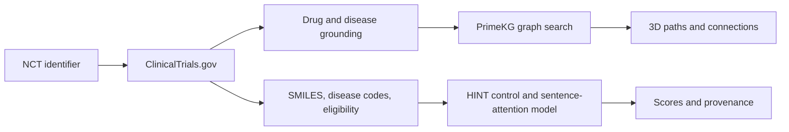
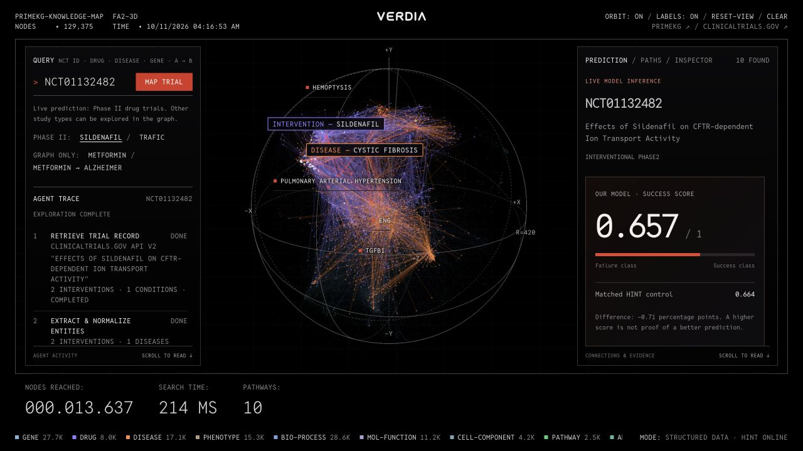

# Verdia

**Explore a clinical trial's biological connections and run a Phase II outcome model.**

Eric Munkhtur · HackRU 2026 · Regeneron challenge

[Live website](https://verdia-hackru-20839887.westus2.cloudapp.azure.com/) · [Read the paper (PDF)](paper/verdia.pdf) · [LaTeX source](paper/verdia.tex) · [Experiments and results](research/README.md) · [Reproduction guide](docs/REPRODUCING.md) · [Demo guide](docs/DEMO.md)

[](https://verdia-hackru-20839887.westus2.cloudapp.azure.com/)

*AI-generated promotional artwork based on Verdia’s graph interface.*

## Try it

Open the website and search **NCT01132482** (sildenafil / cystic fibrosis) or **NCT01928927** (TRAFIC). The graph stays off until a search maps entities; clearing the query resets it. Searches reveal reached nodes and connections progressively.

Predictions support **Phase II interventional drug trials with resolvable inputs**. Other phases and observational studies can still be explored in the graph. Unsupported inputs produce a specific explanation. If an archived TOP prediction exists, it is explicitly labeled as a saved historical result.

## What happens after an NCT search

1. Retrieve the study from ClinicalTrials.gov.
2. Extract structured interventions and conditions, and match them to PrimeKG nodes.
3. Search up to two graph links outward from each side, reconstruct up to 24 connecting paths, and animate the reached subgraph.
4. Independently resolve drug structures with PubChem, map diseases using a dictionary built from TOP training inputs, and encode current eligibility text with BioBERT.
5. Run our fine-tuned sentence-attention HINT and the matched original HINT control on the same inputs. Display both scores and downloadable input/model provenance.



**The PrimeKG paths are not model inputs.** The graph is a separate exploration view. Its 3D positions are a layout, not molecular geometry. The production extraction path uses structured registry fields and lexical matching; no paid LLM is running. Optional LLM integrations remain in the source.

## What we changed in HINT

HINT already combines molecular, disease, and eligibility encoders through an interaction graph. We changed **eligibility sentence pooling**:

- **Sentence attention:** learn which cached BioBERT sentence vectors receive more weight; 1,536 added parameters.
- **Conditioned attention:** use drug and disease representations to guide the sentence weights; 31,040 added parameters.

Both begin with uniform pooling. BioBERT sentence vectors stay fixed during these training runs; the outcome model is fine-tuned from the authors’ Phase II checkpoint. We did not pretrain a new language model or add PrimeKG features to HINT.

### Recorded TOP Phase II results

Matched continuations from the same authors' checkpoint; seed 0; five epochs; 4,005 training / 446 validation / 1,654 test trials. Checkpoint selection uses validation loss.

| Model | Test ROC-AUC | Continuous AP | F1 at 0.5 |
|---|---:|---:|---:|
| Fine-tuned HINT control | 0.632018 | 0.682925 | 0.605844 |
| Sentence attention | 0.632309 | 0.683349 | 0.605592 |
| Conditioned attention | 0.630982 | 0.682502 | 0.596026 |

**Neither modification demonstrated a reliable improvement.** The later conditioned experiment was exploratory after inspecting the earlier test results. These are single-seed comparisons. Separate fresh HINT training runs are documented in [research](research/README.md); they are not the matched control above.

The site reports model scores, not calibrated clinical probabilities or separate efficacy/safety predictions. Benchmark accuracy describes an entire historical test set, not confidence that one trial's score is correct. The two example trials are historical demonstrations; current registry text can differ from the benchmark inputs. Live preprocessing has not been benchmarked end to end.

### Actual website capture



## Run the graph website locally

Use Node.js 22.12+ (deployment used 22.23.3).

```bash
npm ci
npm run primekg
LLM_PROVIDER=mock npm run dev
```

Open `http://localhost:5173`. Vite serves the frontend and Node serves the API on 8790. `mock` means no paid language model; live registry requests still require internet. The first graph build downloads roughly 0.5 GB and needs more memory than serving the compact graph; build it on a development machine rather than the 4 GB hosting VM.

The compact graph and layout are generated locally and gitignored. A fresh clone does **not** include model checkpoints or embedding caches. The graph runs without them; model prediction requires the separate setup in [Reproducing and serving the models](docs/REPRODUCING.md). Training, asset provisioning, and downloading BioBERT are deliberate steps, not part of `npm install`.

```bash
npm run build
```

For public deployments, follow [deploy/README.md](deploy/README.md), including removal of descriptive feature text. The hosted website uses a 2-vCPU / 4-GB Azure Ubuntu VM with a private CPU model worker and Caddy HTTPS. See [model service details](model_service/README.md).

## Repository map

| Path | Contents |
|---|---|
| `src/`, `index.html` | Current Three.js interface and live result panels |
| `server/` | Registry client, PrimeKG search, streaming, prediction queue |
| `model_service/` | CPU inference worker, attention module, attributed upstream HINT code |
| `scripts/` | Graph build and model evidence exporter |
| `research/` | Training source snapshots, aggregate results, configs, histories, provenance |
| `paper/` | Finished technical report as PDF and standalone LaTeX |
| `deploy/` | Deployment configuration and captured demo evidence |
| `app/`, `prep/`, `artifacts/`, `results/`, root `requirements.txt` | Earlier Streamlit prototype retained from the existing GitHub repository; not the deployed site |
| `docs/legacy/` | Earlier planning/design documents; not current performance claims |

## Evidence and limitations

- Source and asset identities, environment records, selected epochs, and training histories are included. [Source manifest](research/provenance/source-manifest.json).
- Original prediction files, trained weights, TOP data, and embedding caches are retained locally; they are not newly distributed in this release. The manifest records identities for the MSI weights and per-trial outputs. Public aggregate metrics alone do not independently verify every prediction.
- A fresh full reproduction from this packaged release has not been performed. Known historical script/path and seeding differences are documented.
- Existing evidence includes browser inspection, successful production builds, and model-serving demonstrations. No new training, load test, or automated test suite was run for this publication.
- No clinical validation, causal explanation claim, or demonstrated prediction improvement.

## Credits and terms

HINT/TOP: Fu et al., [Patterns 2022](https://doi.org/10.1016/j.patter.2022.100445), [upstream repository](https://github.com/futianfan/clinical-trial-outcome-prediction), pinned at `8dc0497f23fdb84e2905da7655924a91e6e79798`. PrimeKG: Chandak, Huang & Zitnik, [Scientific Data 2023](https://doi.org/10.1038/s41597-023-01960-3). BioBERT: [dmis-lab](https://github.com/dmis-lab/biobert). Data services: ClinicalTrials.gov and PubChem.

The existing [MIT license](LICENSE) applies to original Verdia code only. HINT/TOP code and assets have separate noncommercial terms; graph sources, model weights, and the paper's original HINT figure retain their own terms. See [THIRD_PARTY.md](THIRD_PARTY.md). No blanket MIT license is granted over the combined system or its datasets.

AI coding and writing assistants helped with implementation, experiment orchestration, analysis, and drafting. Eric Munkhtur is the project author; the report records the work's limitations and unsuccessful experiments.
